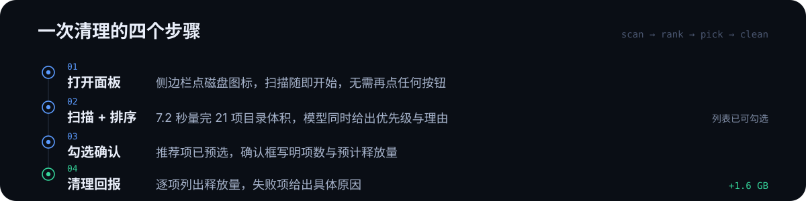
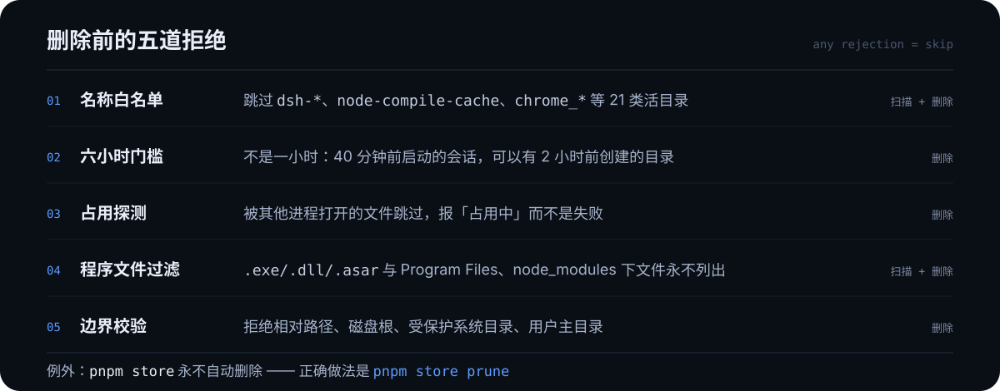

<p align="center">
  
</p>

**点开侧边栏，AI 帮你判断 C / D 盘哪些能删，勾选即清，并逐项回报释放的空间。**

它不问你「要不要清」，而是先量出每个目录到底占多少，再让当前默认模型排出优先级和理由。你只需要看一眼、勾一下。

`DSH 插件` · `Windows 10 / 11` · `Host 5 路由` · `Client 2 槽位` · `116 项断言`

---

## 一次真实扫描

在这台 C 盘只剩 13 GB 的机器上跑一遍：

| 指标 | 实测 |
|---|---|
| 扫描耗时 | **7.2 秒** |
| 发现清理项 | **21 项** |
| C 盘 | 已用 **93.6%**（200 GB 里剩 13 GB） |
| D 盘 | 已用 **77.4%**（275.8 GB 里剩 62 GB） |

排在最前面的几项：

| 清理项 | 体积 | 风险 |
|---|---:|---|
| pnpm 存储 | 7.9 GB | 仅提示 |
| 回收站 | 1.1 GB | 谨慎 |
| Gradle 缓存 | 1.1 GB | 谨慎 |
| Edge 缓存 | 519 MB | 安全 |
| 用户临时文件 | 512 MB | 安全 |
| npm 缓存 | 258 MB | 安全 |

体积是**真跑出来的**，不是估算——每个目录都限时遍历了一遍。

## 怎么用

<p align="center">
  
</p>

1. 左侧边栏点磁盘图标（在「插件」「定时任务」之后）。
2. 面板打开**即自动**扫描 + 分析，不用点任何按钮。
3. 扫描完成后逐项勾选 —— AI 推荐的项默认已勾上。
4. 点「清理选中项」，确认框里写明项数与预计释放量。
5. 结果逐项列出释放量，失败项给出原因。

「重新扫描」随时重跑。「仅提示」的项目不可勾选，只给正确做法。

## 清理项

清理项不是写死的产品清单，而是**按结构发现**的。同样的代码在不同用户的电脑上会找出不同的软件。

| 分类 | 怎么找 | 风险 |
|---|---|---|
| 临时文件 | `%TEMP%`、`%WINDIR%\Temp`、**每个固定盘**的 `Temp/tmp` | 安全 |
| 回收站 | **每个固定盘**的 `$RECYCLE.BIN` | 谨慎 |
| 系统缓存 | Windows 更新缓存、传递优化、字体缓存、日志与转储、Prefetch | 安全 / 谨慎 |
| 系统旧数据 | `Windows.old`、`$WINDOWS~BT` | 高级 |
| 显卡缓存 | 遍历 `%LOCALAPPDATA%` 找 NVIDIA / AMD / D3D 的着色器缓存目录 | 安全 |
| 错误报告 | WER 错误报告与崩溃记录 | 安全 |
| **浏览器** | 遍历 `%LOCALAPPDATA%`，凡符合 `<产品>\<配置>\Cache` 结构的都算 —— 不认产品名 | 安全 |
| **工具链** | 按生态分组发现：Node / Python / Rust / JVM / .NET / Go / Dart / Ruby / PHP / IDE | 安全 / 谨慎 |
| 大文件 | 各盘 ≥300 MB 的**用户数据**，逐个可选 | 谨慎 |
| 仅提示 | pnpm store、休眠文件、WinSxS、系统还原点 | — |

### 为什么是"发现"而不是"清单"

第一版按我知道的软件写死：6 个浏览器（Chrome、Edge、Brave、Vivaldi、360、QQ）、8 个工具链。那就是**开发这台电脑上装的东西**——换个人用 Opera、Arc、Yandex、Whale、UC 浏览器，或写 Flutter、Go、Ruby，全都漏掉。

现在的规则是结构而非名单：

- **浏览器**：`<产品>\User Data\<配置>\Cache` 这个形状就是 Chromium 系，`*\Profiles\*\cache2` 这个形状就是 Firefox 系。发现逻辑在测试里被验证能找出 Opera / Yandex / Whale / Arc / Chromium / UCBrowser —— 这些名字源码里一个都没有。
- **盘符**：不再写死 `C`–`K`，而是读系统真实的固定磁盘列表。装在 `L:` 的盘、或只有 `C:` 的电脑都正确。
- **工具链**：按生态分组，新增一个工具只需在模式表加一行，不必再写一份清理项。

本机实测：自动发现了 **Doubao**（一个带 Chromium profile 的桌面应用）—— 这是写死清单时根本不知道存在的。

本机没装对应软件时该项目不出现。`C:\Windows` 与 `ProgramData` 下需要提权的目录读不了时标**「当前无权限读取」**，而不是假装 0 MB。

大文件只找用户数据。`.exe/.dll/.asar/.node/.wasm/.sys/.pak` 等扩展名，以及 `Program Files`、`Windows`、`node_modules`、`resources\app`、`.git`、`.dsh\profiles` 下的文件一律不列出——删除 `app.asar` 是卸掉一个应用，不是回收垃圾。

## 安全

<p align="center">
  
</p>

### 临时文件不是「删光 %TEMP%」

`%TEMP%` 里住着正在运行的程序的工作目录。其中 `dsh-spill-*` 是 DSH 保存工具完整输出的地方——**删掉会直接打断正在进行中的会话**。所以临时清理有三重保护：

| 保护 | 作用 |
|---|---|
| 名称白名单 | `dsh-*`、`node-compile-cache`、`chrome_*`、`jest_*`、`pnpm-*` 等 21 类活目录跳过 |
| 6 小时 mtime 门槛 | 不是 1 小时。一个 40 分钟前启动的会话，可以有 2 小时前创建的目录 |
| 占用探测 | 被其他进程打开的文件/目录跳过，报为「占用中」而非失败 |

### 为什么 pnpm store 只提示、不删除

`%LOCALAPPDATA%\pnpm\store` 是 pnpm 的内容寻址存储，可能是已装包里每个文件的**同一份数据**。删掉它的后果不是「下次下载慢一点」：

1. 之后任何一次 `pnpm install` 都要全量重下整个依赖图；
2. 若某个依赖的上游 tarball 已失效，安装会在 pnpm 已 prune 之后失败；
3. `node_modules` 因此残缺，profile 里所有插件一起挂掉。

所以它只出现在「仅提示」里，正确做法是 `pnpm store prune`（只删无引用的包）。`pnpm-cache` 元数据缓存是独立的一项，可以删，只影响下载速度。

### 删除边界

- 浏览器只发清理项 **id**，不发路径；路径表在 Host 端固定
- `assertSafeTarget` 拒绝：相对路径、磁盘根、受保护系统目录、用户主目录
- 不跟随符号链接与 junction
- 清理前弹确认框，写明项数与预计释放量
- 路由走宿主自己的 `/api` 信任围栏，无 Connection 服务时退回严格回环 + 同源校验

## 实现

| 半部 | 内容 |
|---|---|
| Host | `/api/disk-cleaner` 5 条路由：`health` / `volumes` / `scan` / `analyze` / `clean` |
| Client | `sidebar.panellist` 图标 + `main` 面板，纯 `createElement`，样式只用 `--dsw-alias-*` 主题令牌 |

扫描用 `fs.statfs` 读容量、限时遍历测目录体积，三路测量并发跑。AI 分析走 `ctx.llm.stream` + `agentDefaultModel.currentSelection()`，模型回复按 JSON 解析——解析失败、回复被代码围栏包住、或压根没挂模型，都会自动退回按体积排序，不会卡住面板。

## 测试

```bash
node test/smoke.mjs     # 真实扫描本机，含 AI 解析三种分支
node test/guards.mjs    # 信任围栏、参数校验、删除边界        18 项
node test/render.mjs    # 面板真实渲染：扫描→排序→勾选→清理   22 项
node test/safety.mjs    # pnpm store 保护、临时白名单、程序文件过滤  77 项
node test/audit.mjs     # 目录审计：路径重叠、可达性、测量=删除、不穿透链接
node test/portable.mjs  # 可移植性：模拟陌生浏览器/无软件/嵌套目录的电脑  16 项
```

全部通过。`safety.mjs` 与 `audit.mjs` 在临时沙箱里验证「面板显示要删的量 = 实际删掉的量」，`portable.mjs` 在沙箱里造出别的用户电脑，都不动真实文件。

## 安装

把插件检出目录通过 `link:` 依赖挂到 `desktop` profile：

```json
"dsh-disk-cleaner": "link:<检出目录>"
```

改代码后执行一次「插件」页里的开关（关 → 开），或重启 GUI，即生效。

需要 DSH 0.2.x 与 Windows 10 / 11。
